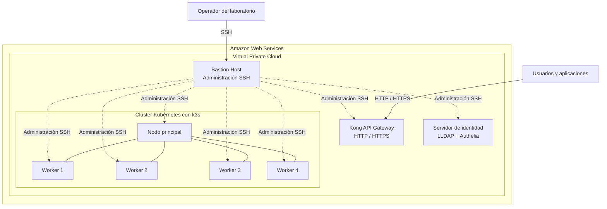
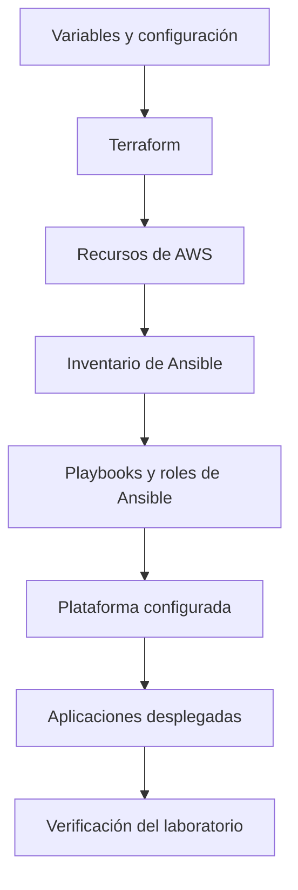

# Infraestructura como Código para el Laboratorio del Bootcamp EspecializATT


Repositorio de **Infraestructura como Código (IaC)** para crear,
configurar y desplegar el laboratorio tecnológico del Bootcamp
EspecializATT.

El proyecto automatiza la preparación de un entorno de laboratorio
en Amazon Web Services (AWS), utilizando Terraform para aprovisionar
la infraestructura y Ansible para configurar los servidores,
instalar los componentes de plataforma y desplegar las aplicaciones.

El laboratorio integra infraestructura de red, instancias EC2,
un bastion host, Kong API Gateway, servicios de identidad y un
clúster Kubernetes basado en k3s.

Su propósito es proporcionar un entorno reproducible para realizar
prácticas de arquitectura de microservicios, infraestructura como
código, automatización, identidad, seguridad y despliegue de
aplicaciones.

> **Importante:** este repositorio está destinado a un entorno
> educativo. La configuración debe evaluarse y endurecerse antes
> de utilizarse en producción.

---

## Tabla de contenidos

- [1. Propósito del proyecto](#1-propósito-del-proyecto)
- [2. Objetivos de aprendizaje](#2-objetivos-de-aprendizaje)
- [3. Alcance](#3-alcance)
- [4. Arquitectura](#4-arquitectura)
- [5. Componentes de infraestructura](#5-componentes-de-infraestructura)
- [6. Organización del repositorio](#6-organización-del-repositorio)
- [7. Requisitos previos](#7-requisitos-previos)
- [8. Preparación del entorno](#8-preparación-del-entorno)
- [9. Aprovisionamiento con Terraform](#9-aprovisionamiento-con-terraform)
- [10. Configuración con Ansible](#10-configuración-con-ansible)
- [11. Despliegue de aplicaciones](#11-despliegue-de-aplicaciones)
- [12. Verificación del laboratorio](#12-verificación-del-laboratorio)
- [13. Configuración y personalización](#13-configuración-y-personalización)
- [14. Seguridad](#14-seguridad)
- [15. Costos y administración de recursos](#15-costos-y-administración-de-recursos)
- [16. Destrucción del laboratorio](#16-destrucción-del-laboratorio)
- [17. Solución de problemas](#17-solución-de-problemas)
- [18. Relación con el repositorio de aplicaciones](#18-relación-con-el-repositorio-de-aplicaciones)
- [19. Referencias oficiales](#19-referencias-oficiales)
- [20. Licencia](#20-licencia)

---

## 1. Propósito del proyecto

El repositorio contiene la automatización necesaria para construir
el entorno de infraestructura utilizado en el Bootcamp EspecializATT.

En lugar de configurar manualmente cada servidor, red y componente,
el laboratorio utiliza herramientas de infraestructura como código
y gestión de configuración.

La solución se divide en dos etapas principales:

**Aprovisionamiento de infraestructura**

Terraform declara y administra los recursos de AWS necesarios para
construir la base del laboratorio, incluyendo la red y las instancias
de cómputo.

**Configuración y despliegue**

Ansible configura los servidores, instala los componentes requeridos,
prepara el clúster Kubernetes y automatiza el despliegue de los
componentes de plataforma y las aplicaciones.

Esta separación permite mantener el código de infraestructura
independiente de las tareas de configuración del sistema operativo
y del despliegue de las aplicaciones.

## 2. Objetivos de aprendizaje

El laboratorio proporciona una base práctica para estudiar los
siguientes conceptos:

- Infraestructura como Código (IaC).
- Aprovisionamiento de recursos en AWS mediante Terraform.
- Modularización y reutilización de configuraciones Terraform.
- Administración de inventarios y variables con Ansible.
- Automatización de la configuración de servidores Linux.
- Diseño de redes virtuales y reglas de seguridad en AWS.
- Administración de servidores privados mediante un bastion host.
- Despliegue de un clúster Kubernetes ligero con k3s.
- Publicación y enrutamiento de APIs mediante Kong API Gateway.
- Gestión de identidad y autenticación con LLDAP y Authelia.
- Despliegue automatizado de aplicaciones y servicios de plataforma.
- Aplicación de prácticas de seguridad durante la preparación
  y operación de un entorno de laboratorio.

Los objetivos anteriores describen las capacidades que el laboratorio
permite estudiar. No constituyen, por sí solos, una certificación
de que la infraestructura cumple requisitos de producción.

## 3. Alcance

### 3.1. Incluido

El repositorio contempla la automatización de los siguientes
componentes:

- Red virtual y recursos de conectividad en AWS.
- Subredes y grupos de seguridad.
- Instancias EC2 para los componentes del laboratorio.
- Bastion host para la administración de servidores.
- Kong API Gateway como punto de entrada del tráfico HTTP/HTTPS.
- Servidor de identidad con LLDAP y Authelia.
- Clúster Kubernetes basado en k3s.
- Componentes internos de la plataforma.
- Despliegue de las aplicaciones del bootcamp.
- Generación automática del inventario de Ansible a partir de
  la infraestructura aprovisionada.

### 3.2. Fuera del alcance

Este repositorio se concentra en la infraestructura y su
automatización.

El código fuente de los microservicios y sus proyectos de pruebas
se mantiene en un repositorio independiente.

La implementación del sistema monolítico original tampoco forma
parte de este repositorio.

La disponibilidad de cada componente depende de la configuración
y del resultado de la ejecución de los playbooks.

---

## 4. Arquitectura

### 4.1. Vista general

La infraestructura se despliega en AWS y organiza los recursos
dentro de una VPC.

El diseño contempla ocho instancias EC2 en su configuración
documentada:

- Un bastion host.
- Una instancia para Kong API Gateway.
- Una instancia para los servicios de identidad.
- Un nodo principal de k3s.
- Cuatro nodos de trabajo de k3s.

Los tipos de instancia y la región pueden ajustarse mediante
las variables de configuración admitidas por Terraform.

### 4.2. Diagrama de infraestructura



El diagrama representa la organización lógica de los componentes.
La conectividad efectiva depende de las subredes, rutas, grupos
de seguridad y reglas de acceso configuradas en AWS.

### 4.3. Flujo de aprovisionamiento y configuración

La preparación del laboratorio sigue este flujo:



Terraform se utiliza para declarar y aprovisionar recursos.

Ansible utiliza el inventario generado para conectarse a los servidores
y ejecutar las tareas de configuración correspondientes.

### 4.4. Administración mediante bastion host

El bastion host proporciona el punto de entrada SSH previsto para
la administración de los servidores internos.

Los servidores administrados mediante este mecanismo no deben
requerir exposición pública directa de SSH.

El acceso debe limitarse a las direcciones IP autorizadas y a las
reglas de red estrictamente necesarias.

La topología efectiva y los permisos de acceso deben verificarse
en los módulos Terraform y en los grupos de seguridad desplegados.

---

## 5. Componentes de infraestructura

### 5.1. Red

La configuración de red se encuentra en:

`terraform/modules/network/`

Su responsabilidad es proporcionar los recursos de conectividad
necesarios para los componentes del laboratorio.

Incluye la configuración de red virtual, subredes y grupos de
seguridad declarados por el módulo.

### 5.2. Cómputo y punto de entrada

La configuración se encuentra en:

`terraform/modules/compute/`

Este módulo administra los recursos de cómputo correspondientes
al bastion host y a Kong API Gateway, así como la configuración
de la clave SSH utilizada por el laboratorio.

Kong proporciona el punto de entrada para el tráfico HTTP/HTTPS
que llega a las APIs publicadas.

### 5.3. Servicios de identidad

La configuración de infraestructura se encuentra en:

`terraform/modules/identity/`

La configuración de software se encuentra en:

`ansible/roles/identity/`

El servidor de identidad utiliza LLDAP y Authelia para proporcionar
las funciones de directorio y autenticación configuradas para
el laboratorio.

Las integraciones y políticas efectivamente disponibles dependen
de los archivos de configuración desplegados por Ansible.

### 5.4. Kubernetes

La configuración de infraestructura se encuentra en:

`terraform/modules/k8s/`

El clúster utiliza k3s y está compuesto por un nodo principal
y cuatro nodos de trabajo en la configuración documentada.

Los roles de Ansible permiten configurar los nodos y desplegar
los componentes correspondientes de la plataforma.

### 5.5. Automatización de la plataforma

Los roles de Ansible organizan las tareas para:

- Configurar los servicios de identidad.
- Instalar y configurar Kong.
- Preparar el clúster k3s.
- Desplegar los componentes internos.
- Desplegar las aplicaciones del bootcamp.
- Gestionar la carga de usuarios del laboratorio.

### 5.6. Inventario automático

Terraform genera el inventario de Ansible a partir de los datos
de la infraestructura.

Archivo generado:

`ansible/inventory.ini`

El inventario contiene la información necesaria para identificar
los hosts y grupos utilizados por los playbooks.

Este archivo es un artefacto generado localmente y no debe incluirse
en el repositorio si contiene direcciones, rutas o información
específica del entorno.

---

## 6. Organización del repositorio

La estructura principal es la siguiente:

```text
.
├── terraform/
│   ├── main.tf
│   ├── providers.tf
│   ├── variables.tf
│   ├── outputs.tf
│   ├── terraform.tfvars.example
│   └── modules/
│       ├── network/
│       ├── compute/
│       ├── identity/
│       └── k8s/
│
├── ansible/
│   ├── site.yml
│   ├── despliegue.yml
│   ├── despliegue-apps-internas.yml
│   ├── load_users.yml
│   └── roles/
│       ├── identity/
│       ├── kong/
│       ├── k3s/
│       ├── despliegue-interno/
│       ├── despliegue-apps/
│       └── load_bootcamp_users/
│
├── .gitignore
└── README.md
```

### 6.1. Directorio `terraform/`

Contiene las configuraciones declarativas de infraestructura.

- `main.tf`: composición y orquestación de los módulos.
- `providers.tf`: configuración de Terraform y proveedores.
- `variables.tf`: definición de variables de entrada.
- `outputs.tf`: definición de salidas.
- `terraform.tfvars.example`: plantilla de configuración.
- `modules/`: módulos reutilizables de infraestructura.

### 6.2. Directorio `ansible/`

Contiene los playbooks y roles utilizados para configurar
los servidores y desplegar los componentes de software.

Los playbooks de nivel superior coordinan las tareas; los roles
encapsulan las responsabilidades de configuración.

### 6.3. Separación de responsabilidades

Terraform administra el ciclo de vida de los recursos declarados
en su configuración.

Ansible configura los sistemas operativos, instala componentes
y despliega software.

Esta separación facilita revisar los cambios de infraestructura
y de configuración de manera independiente.

---

## 7. Requisitos previos

Antes de ejecutar el laboratorio, prepara un equipo de administración
con Linux o macOS.

En Windows se recomienda utilizar WSL con una distribución Linux
compatible.

### 7.1. Herramientas necesarias

**Terraform**

Versión mínima documentada: `1.5.0`.

Instalación oficial:

https://developer.hashicorp.com/terraform/install

**Ansible**

Se necesita Ansible para ejecutar los playbooks de configuración.

Guía oficial de instalación:

https://docs.ansible.com/ansible/latest/installation_guide/

La versión mínima de Ansible debe confirmarse con las colecciones
y módulos utilizados por los roles del repositorio.

**AWS CLI**

Se utiliza para configurar y seleccionar las credenciales de AWS.

Instalación oficial:

https://docs.aws.amazon.com/cli/latest/userguide/getting-started-install.html

**Cliente SSH**

Se utiliza para administrar los servidores y para las conexiones
que requieren los playbooks de Ansible.

### 7.2. Cuenta de AWS

Se requiere una cuenta de AWS con permisos suficientes para crear
y administrar los recursos definidos por los módulos Terraform.

Dependiendo de la configuración, esto incluye recursos de red,
grupos de seguridad, instancias EC2 y pares de claves.

Se recomienda utilizar credenciales temporales o un mecanismo
de autenticación apropiado para el entorno de trabajo, evitando
almacenar claves de acceso en el repositorio.

### 7.3. Conectividad

El equipo de administración necesita acceso a los servicios de AWS
y a los repositorios necesarios para descargar proveedores,
colecciones y dependencias.

Los grupos de seguridad deben permitir únicamente el tráfico
necesario para las tareas de administración y el funcionamiento
del laboratorio.

---

## 8. Preparación del entorno

### 8.1. Clonar el repositorio

```bash
git clone https://github.com/bootcamp-att/infraestructura.git

cd infraestructura
```

### 8.2. Configurar AWS CLI

Crea un perfil local para el laboratorio:

```bash
aws configure --profile bootcamp
```

Configura las credenciales y la región según tu entorno.

Selecciona el perfil para la sesión actual:

```bash
export AWS_PROFILE=bootcamp
```

Verifica que las credenciales sean válidas:

```bash
aws sts get-caller-identity
```

El comando devuelve información de la identidad utilizada por AWS CLI.

No publiques las credenciales configuradas localmente.

### 8.3. Preparar las variables de Terraform

Entra al directorio de Terraform:

```bash
cd terraform
```

Copia la plantilla:

```bash
cp terraform.tfvars.example terraform.tfvars
```

Edita `terraform.tfvars` para ajustar los valores necesarios
para tu laboratorio.

Por ejemplo, puedes modificar la región, el nombre del entorno,
el rango CIDR de la VPC o los tipos de instancia, siempre que
las variables y los módulos admitan esos valores.

El archivo `terraform.tfvars` debe permanecer fuera del control
de versiones.

---

## 9. Aprovisionamiento con Terraform

### 9.1. Inicializar Terraform

Desde el directorio `terraform/`:

```bash
terraform init
```

Este comando inicializa el directorio de trabajo y descarga
los proveedores requeridos por la configuración.

Si utilizas proveedores versionados mediante `.terraform.lock.hcl`,
conserva ese archivo en Git para facilitar ejecuciones reproducibles.

### 9.2. Validar la configuración

```bash
terraform fmt -recursive

terraform validate
```

`terraform fmt` normaliza el formato de los archivos Terraform.

`terraform validate` comprueba la consistencia sintáctica y
estructural de la configuración inicializada.

El formato de los archivos debe revisarse antes de confirmar
cambios en el repositorio.

### 9.3. Revisar el plan

```bash
terraform plan
```

Revisa las acciones que Terraform propone antes de crear o modificar
recursos.

Comprueba especialmente:

- Región de AWS.
- Rango CIDR de la VPC.
- Tipos de instancia.
- Recursos que se crearán o modificarán.
- Reglas de acceso de los grupos de seguridad.
- Recursos que podrían generar costos.

No continúes si el plan incluye cambios que no esperabas.

### 9.4. Crear la infraestructura

```bash
terraform apply
```

Revisa nuevamente el plan presentado por Terraform y confirma
la operación cuando estés seguro de que los recursos son correctos.

La operación puede tardar varios minutos.

Al finalizar, consulta las salidas generadas:

```bash
terraform output
```

El inventario de Ansible se genera durante el proceso definido
por la configuración del repositorio.

Comprueba que exista:

```text
ansible/inventory.ini
```

Si el archivo no se encuentra en esa ruta, revisa el resultado
de Terraform y la configuración de generación del inventario.

### 9.5. Consultar las salidas individualmente

Desde el directorio `terraform/`:

```bash
terraform output bastion_public_ip

terraform output kong_public_ip

terraform output kong_private_ip
```

Para obtener un valor sin formato adicional:

```bash
terraform output -raw bastion_public_ip
```

La ruta de la clave privada generada puede consultarse con:

```bash
terraform output -raw private_key_file
```

La disponibilidad de cada salida depende de la configuración
aplicada.

---

## 10. Configuración con Ansible

Una vez creada la infraestructura, cambia al directorio de Ansible:

```bash
cd ../ansible
```

### 10.1. Verificar el inventario

Comprueba que el inventario generado esté disponible:

```bash
ansible-inventory -i inventory.ini --graph
```

La salida permite revisar los grupos y hosts que Ansible reconoce.

Los grupos documentados incluyen:

- `bastion`
- `kong`
- `identity`
- `k8s_master`
- `k8s_workers`
- `k8s`

### 10.2. Comprobar la conectividad

Ejecuta:

```bash
ansible all -i inventory.ini -m ping
```

Este comando permite verificar la conectividad de Ansible con
los hosts incluidos en el inventario.

Si la conexión falla, revisa la configuración SSH, los grupos
de seguridad, el estado de las instancias y la ruta de acceso
a los servidores privados.

### 10.3. Ejecutar el playbook principal

```bash
ansible-playbook -i inventory.ini site.yml
```

Este playbook coordina las tareas principales de configuración
de los componentes declarados en el proyecto.

Su ejecución depende de que la infraestructura esté disponible
y de que las variables, claves y archivos requeridos estén
correctamente configurados.

### 10.4. Cargar los usuarios del laboratorio

```bash
ansible-playbook -i inventory.ini load_users.yml
```

Este playbook ejecuta las tareas relacionadas con la carga de
usuarios del bootcamp en el sistema de identidad configurado.

Verifica las variables y los archivos requeridos por el rol antes
de ejecutarlo.

### 10.5. Desplegar las aplicaciones

```bash
ansible-playbook -i inventory.ini despliegue-apps-internas.yml
```

Este playbook coordina el despliegue de las aplicaciones del
bootcamp en Kubernetes.

Para conocer los recursos y las imágenes utilizados, consulta
los roles de Ansible correspondientes.

---

## 11. Despliegue de aplicaciones

El repositorio de infraestructura y el repositorio de aplicaciones
mantienen responsabilidades diferentes.

El repositorio de infraestructura prepara los recursos y automatiza
el despliegue.

El repositorio de aplicaciones contiene el código fuente de los
microservicios y los proyectos de pruebas.

### 11.1. Repositorio de aplicaciones

Código fuente:

https://github.com/bootcamp-att/aplicativos

Este repositorio contiene los servicios de catálogo, descuentos
y productos, así como proyectos de pruebas funcionales,
rendimiento y pruebas de concepto.

### 11.2. Flujo de despliegue

El flujo general es:

1. Aprovisionar los recursos de AWS con Terraform.
2. Generar el inventario de Ansible.
3. Configurar los servidores mediante los playbooks.
4. Preparar el clúster Kubernetes.
5. Desplegar los componentes internos.
6. Desplegar las aplicaciones.
7. Verificar la conectividad y el comportamiento de los servicios.

La secuencia exacta depende de las dependencias declaradas
en los playbooks y roles.

### 11.3. Arquitectura de las aplicaciones

El laboratorio está preparado para alojar las aplicaciones del
bootcamp sobre Kubernetes.

En el escenario de la tienda en línea, Kong recibe las solicitudes
externas y las encamina hacia la API publicada en el clúster.

El microservicio de productos coordina las consultas a los servicios
de catálogo y descuentos. Estos últimos mantienen sus respectivas
bases de datos PostgreSQL.

La definición de los contratos y el comportamiento de las APIs
deben consultarse en el repositorio de aplicaciones.

---

## 12. Verificación del laboratorio

La verificación debe realizarse después de aprovisionar y configurar
los recursos.

### 12.1. Verificar el inventario

Desde `ansible/`:

```bash
ansible-inventory -i inventory.ini --graph
```

Comprueba que los hosts y grupos esperados estén presentes.

### 12.2. Verificar la conectividad

```bash
ansible all -i inventory.ini -m ping
```

Revisa que los hosts accesibles respondan correctamente.

### 12.3. Consultar los recursos de AWS

Desde `terraform/`:

```bash
terraform output
```

Verifica las direcciones y los valores necesarios para administrar
el laboratorio.

### 12.4. Verificar Kubernetes

Una vez que k3s esté configurado, utiliza el acceso administrativo
preparado por los roles para comprobar el estado del clúster.

Por ejemplo, desde el nodo principal y con los permisos apropiados:

```bash
sudo kubectl get nodes -o wide
```

Comprueba que los nodos esperados estén registrados y revisa
su estado.

Para consultar los pods:

```bash
sudo kubectl get pods -A
```

La ejecución de estos comandos depende de que `kubectl` y el acceso
a la configuración del clúster estén disponibles en el host.

### 12.5. Verificar las aplicaciones

Comprueba que los recursos desplegados estén disponibles:

```bash
sudo kubectl get deployments -A

sudo kubectl get services -A

sudo kubectl get ingress -A
```

La existencia de recursos no garantiza que todas las aplicaciones
estén funcionando correctamente. Revisa el estado de los pods,
los eventos de Kubernetes y los registros cuando sea necesario.

---

## 13. Configuración y personalización

Las variables disponibles deben consultarse en:

`terraform/variables.tf`

Los valores utilizados para una ejecución particular se configuran
en:

`terraform/terraform.tfvars`

Este último archivo no debe versionarse.

### 13.1. Región de AWS

La región predeterminada documentada es:

`us-east-1`

Puedes seleccionar otra región si los recursos, las imágenes
y los tipos de instancia utilizados están disponibles allí.

### 13.2. Nombre del entorno

La variable `environment` permite identificar el entorno de
laboratorio cuando se utiliza en los recursos correspondientes.

El valor predeterminado documentado es:

`dev`

### 13.3. Red

El rango CIDR predeterminado documentado es:

`10.0.0.0/16`

Antes de modificarlo, comprueba que no se solape con otras redes
a las que deban conectarse los participantes o los servidores.

### 13.4. Tipos de instancia

Los tipos documentados incluyen:

- `t3.micro` para el bastion.
- `t3.small` para Kong y los demás componentes descritos
  en la configuración del laboratorio.

La disponibilidad de tipos de instancia y sus costos dependen
de la región y de las condiciones de AWS.

### 13.5. Salidas de Terraform

Entre las salidas documentadas se encuentran:

- `bastion_public_ip`: dirección pública del bastion.
- `kong_public_ip`: dirección pública de Kong.
- `kong_private_ip`: dirección privada de Kong.
- `private_key_file`: ruta de la clave privada generada.

Consulta `terraform/outputs.tf` para conocer las salidas efectivamente
definidas.

---

## 14. Seguridad

Este laboratorio está diseñado para formación y experimentación.
No debe asumirse que su configuración cumple automáticamente
los requisitos de un entorno productivo.

### 14.1. Credenciales de AWS

No almacenes claves de acceso, secretos o credenciales en el
repositorio.

Utiliza perfiles locales de AWS CLI, credenciales temporales
o mecanismos de autenticación adecuados para el entorno.

### 14.2. Variables sensibles

No publiques archivos que contengan contraseñas, tokens, claves
privadas u otros valores sensibles.

Los archivos locales de variables de Terraform deben mantenerse
fuera del control de versiones.

### 14.3. Estado y planes de Terraform

Los archivos de estado y los planes guardados pueden contener
información sensible.

No los publiques en Git ni los compartas sin controles de acceso.

El archivo `.terraform.lock.hcl` debe versionarse normalmente:
contiene las selecciones y comprobaciones de integridad de los
proveedores, no sustituye al estado de Terraform.

### 14.4. Claves SSH

Protege las claves privadas generadas por el laboratorio.

En sistemas Linux, comprueba sus permisos:

```bash
chmod 600 /ruta/a/la/clave-privada
```

No copies claves privadas en archivos de inventario que se vayan
a publicar ni las incluyas en documentación.

### 14.5. Bastion host

Limita el acceso SSH a las direcciones IP autorizadas.

Evita exponer el puerto 22 a todo Internet cuando no sea necesario.

Cuando termines de utilizar el laboratorio, detén o elimina
los recursos que ya no necesites, considerando las dependencias
de administración y los costos.

Detener el bastion puede impedir la administración de los servidores
privados mediante la ruta prevista. Verifica primero si todavía
necesitas ese acceso.

### 14.6. Grupos de seguridad

Aplica el principio de mínimo privilegio:

- Permite únicamente los puertos necesarios.
- Restringe los orígenes de tráfico.
- Evita exponer directamente los servicios internos.
- Revisa las reglas antes de aplicar cambios.
- Verifica el acceso efectivo después del despliegue.

### 14.7. Entorno de laboratorio

Antes de utilizar el entorno con participantes, revisa las
credenciales, los usuarios de prueba, los permisos, los puertos
publicados y los mecanismos de autenticación.

No utilices datos reales ni credenciales de producción en
las prácticas.

---

## 15. Costos y administración de recursos

El laboratorio utiliza instancias EC2 y otros recursos de AWS
que pueden generar cargos mientras existan.

La configuración documentada contempla ocho instancias:

- Siete instancias `t3.small`.
- Una instancia `t3.micro`.

Esta descripción corresponde a la configuración documentada
y debe verificarse si se modifican los módulos o las variables.

El costo total también puede incluir almacenamiento, direcciones
IPv4 públicas, transferencia de datos y otros recursos facturables,
según la configuración y los precios vigentes de AWS.

Consulta la calculadora oficial:

https://calculator.aws/

### Recomendaciones para controlar los costos

- Revisa el plan antes de crear recursos.
- Utiliza el laboratorio durante el tiempo necesario.
- Evita mantener instancias encendidas sin utilizarlas.
- Revisa los recursos existentes en la consola de AWS.
- Configura alertas de presupuesto cuando corresponda.
- Destruye el laboratorio cuando ya no sea necesario.

Detener una instancia EC2 no elimina necesariamente todos los
costos asociados a los recursos que siguen existiendo.

---

## 16. Destrucción del laboratorio

Cuando termines de utilizar el laboratorio, elimina los recursos
administrados por Terraform para evitar cargos innecesarios.

### 16.1. Revisar el entorno

Entra al directorio de Terraform:

```bash
cd terraform
```

Comprueba las salidas:

```bash
terraform output
```

Asegúrate de estar utilizando la cuenta, el perfil y la configuración
correctos.

### 16.2. Revisar el plan de destrucción

```bash
terraform plan -destroy
```

Revisa los recursos que se eliminarán antes de continuar.

### 16.3. Destruir los recursos

```bash
terraform destroy
```

Confirma la operación únicamente después de verificar que se trata
del laboratorio que deseas eliminar.

Este comando puede eliminar todos los recursos administrados
por la configuración Terraform correspondiente.

No lo ejecutes contra un entorno compartido o productivo sin
autorización y revisión previa.

### 16.4. Verificar la limpieza

Después de la operación, revisa la salida de Terraform y comprueba
en la consola de AWS que no queden recursos del laboratorio que
sigan generando costos.

La limpieza debe contemplar los recursos que pertenezcan a la
configuración administrada y cualquier recurso externo creado
por separado.

---

## 17. Solución de problemas

### Error: `failed to get shared config profile`

**Causa probable:** el perfil de AWS CLI no existe o no está
disponible en la sesión actual.

Comprueba los perfiles:

```bash
aws configure list-profiles
```

Selecciona el perfil correcto:

```bash
export AWS_PROFILE=bootcamp
```

Verifica la identidad:

```bash
aws sts get-caller-identity
```

### Error: `UNPROTECTED PRIVATE KEY FILE`

**Causa probable:** los permisos de la clave privada SSH son
demasiado amplios.

Corrige los permisos:

```bash
chmod 600 /ruta/a/la/clave-privada
```

### Error: Ansible muestra `UNREACHABLE` o `Connection timed out`

**Causas posibles:**

- Las instancias todavía están iniciando.
- El inventario contiene direcciones incorrectas o desactualizadas.
- El bastion no está disponible.
- La configuración SSH no es correcta.
- Los grupos de seguridad no permiten el tráfico necesario.
- La clave privada no corresponde a la instancia.

Consulta las salidas de Terraform y revisa la conectividad
antes de repetir los playbooks.

### Error: no existe `ansible/inventory.ini`

**Causa probable:** el aprovisionamiento no ha finalizado o el
inventario no se generó en la ruta esperada.

Revisa la salida de Terraform y la configuración responsable
de generar el inventario.

`terraform plan` no aplica cambios ni ejecuta por sí mismo las
operaciones de creación de recursos previstas en el plan.

### Error durante `terraform init`

**Causas posibles:**

- No hay conectividad con los registros de proveedores.
- La configuración requiere una versión de Terraform incompatible.
- Los proveedores no pueden descargarse.
- La configuración o el archivo de bloqueo necesitan revisión.

Consulta el mensaje completo de error antes de modificar
las restricciones de versiones.

### Los pods no están disponibles en Kubernetes

Comprueba el estado de los recursos:

```bash
sudo kubectl get pods -A

sudo kubectl get events -A
```

Consulta los registros del pod afectado:

```bash
sudo kubectl logs -n <namespace> <pod>
```

Sustituye `<namespace>` y `<pod>` por los valores reales.

Verifica también la disponibilidad de los servicios dependientes,
las variables de entorno y la configuración de red.

---

## 18. Relación con el repositorio de aplicaciones

El proyecto de infraestructura se mantiene separado del código
fuente de las aplicaciones.

### Infraestructura

Repositorio:

https://github.com/bootcamp-att/infraestructura

Responsabilidades:

- Aprovisionamiento de recursos.
- Configuración de servidores.
- Preparación del clúster Kubernetes.
- Instalación de componentes de plataforma.
- Despliegue automatizado de las aplicaciones.

### Aplicaciones

Repositorio:

https://github.com/bootcamp-att/aplicativos

Responsabilidades:

- Código fuente de los microservicios.
- Contratos y configuración de las APIs.
- Proyectos de pruebas funcionales.
- Proyectos de pruebas de rendimiento.
- Pruebas de concepto.
- Documentación técnica de las aplicaciones.

### Separación de responsabilidades

El repositorio de aplicaciones define el comportamiento de los
servicios.

El repositorio de infraestructura proporciona los recursos
y la automatización necesarios para preparar el entorno donde
se ejecutan.

Esta separación permite evolucionar las aplicaciones sin mezclar
su código fuente con la configuración de aprovisionamiento
y administración de la plataforma.

---

## 19. Referencias oficiales

### Terraform

- Instalación: https://developer.hashicorp.com/terraform/install
- Tutoriales: https://developer.hashicorp.com/terraform/tutorials
- Lenguaje y estilo: https://developer.hashicorp.com/terraform/language/style
- Gestión del estado: https://developer.hashicorp.com/terraform/language/state
- Gestión de datos sensibles: https://developer.hashicorp.com/terraform/language/manage-sensitive-data

### Ansible

- Documentación: https://docs.ansible.com/ansible/latest/
- Guía de instalación: https://docs.ansible.com/ansible/latest/installation_guide/
- Playbooks: https://docs.ansible.com/ansible/latest/playbook_guide/

### Amazon Web Services

- Documentación de AWS: https://docs.aws.amazon.com/
- AWS CLI: https://docs.aws.amazon.com/cli/latest/userguide/
- Amazon EC2: https://docs.aws.amazon.com/ec2/
- Amazon VPC: https://docs.aws.amazon.com/vpc/
- Calculadora de precios: https://calculator.aws/

### Kubernetes y k3s

- Kubernetes: https://kubernetes.io/docs/
- k3s: https://docs.k3s.io/

### Kong Gateway

- Documentación: https://docs.konghq.com/gateway/latest/

### Authelia y LLDAP

- Authelia: https://www.authelia.com/
- LLDAP: https://github.com/lldap/lldap

---

## 20. Licencia

La licencia del proyecto está pendiente de definición.

Antes de publicar una licencia, confirma que tienes autorización
para distribuir el código y los materiales incluidos en el
repositorio.

Consulta el archivo `LICENSE` si se incorpora una licencia formal.

---

**Bootcamp EspecializATT**

Infraestructura como Código para la preparación automatizada
del laboratorio de formación.