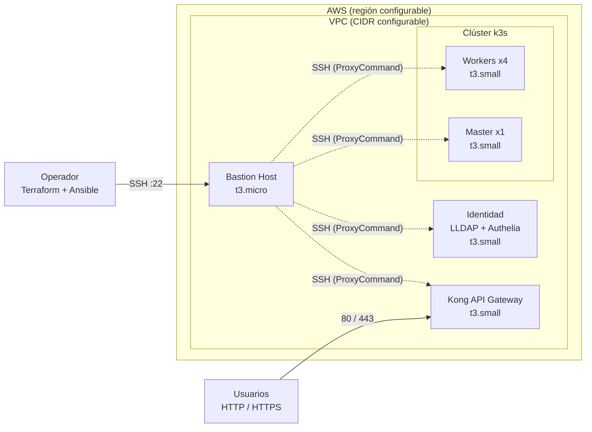

# Infraestructura como Código para el Laboratorio del Bootcamp


Este repositorio contiene el código para crear, de forma reproducible, el laboratorio del **Bootcamp EspecializATT**: una red en AWS con un bastion, un API Gateway, un servidor de identidad y un clúster Kubernetes (k3s), todo aprovisionado con **Terraform** y configurado con **Ansible**.

> **Alcance:** es un entorno de laboratorio para formación. No está endurecido para producción (ver [Seguridad](#seguridad)).

## Tabla de contenidos

- [Arquitectura](#arquitectura)
- [Estructura del repositorio](#estructura-del-repositorio)
- [Requisitos previos](#requisitos-previos)
- [Inicio rápido](#inicio-rápido)
- [Configuración](#configuración)
- [Playbooks de Ansible](#playbooks-de-ansible)
- [Verificación](#verificación)
- [Destruir el laboratorio](#destruir-el-laboratorio)
- [Seguridad](#seguridad)
- [Solución de problemas](#solución-de-problemas)
- [Costos](#costos)
- [Recursos](#recursos)

## Arquitectura




| Componente | Módulo Terraform | Rol Ansible | Función |
|---|---|---|---|
| Red (VPC, subred, Security Groups) | `modules/network` | — | Base de red del laboratorio |
| Bastion Host | `modules/compute` | — | Único punto de entrada SSH para gestionar el resto de los servidores |
| Kong API Gateway | `modules/compute` | `kong` | Entrada de tráfico HTTP/HTTPS |
| Servidor de identidad | `modules/identity` | `identity` | Docker, LLDAP y Authelia |
| Clúster Kubernetes | `modules/k8s` | `k3s`, `despliegue-interno`, `despliegue-apps` | 1 master + 4 workers con k3s; infraestructura interna y microservicios |

Terraform genera automáticamente el inventario de Ansible (`ansible/inventory.ini`), de modo que las IPs y la llave SSH nunca se copian a mano. Los servidores privados se administran **a través del bastion**.

## Estructura del repositorio

```text
.
├── terraform/
│   ├── main.tf                  # Orquestación de módulos + generación del inventario
│   ├── providers.tf             # Versiones de Terraform y providers (aws, tls, local)
│   ├── variables.tf             # Variables de entrada
│   ├── outputs.tf               # Salidas (IPs, ruta de la llave SSH)
│   ├── terraform.tfvars.example # Plantilla de configuración (copiar a terraform.tfvars)
│   └── modules/
│       ├── network/             # VPC, subred y Security Groups
│       ├── compute/             # Bastion, Kong y llave SSH
│       ├── identity/            # Servidor de identidad (LLDAP + Authelia)
│       └── k8s/                 # Master y workers de k3s
└── ansible/
    ├── site.yml                 # Despliegue base completo
    ├── despliegue.yml           # Infraestructura interna en Kubernetes
    ├── despliegue-apps-internas.yml  # Microservicios en Kubernetes
    ├── load_users.yml           # Carga de usuarios del bootcamp
    └── roles/
        ├── identity/            # Docker, Authelia y LLDAP
        ├── kong/                # Kong API Gateway
        ├── k3s/                 # Clúster k3s (master y workers)
        ├── despliegue-interno/  # Componentes internos en Kubernetes
        ├── despliegue-apps/     # Microservicios del bootcamp
        └── load_bootcamp_users/ # Usuarios en Authelia / LLDAP
```

## Requisitos previos

| Herramienta | Versión | Notas |
|---|---|---|
| [Terraform](https://developer.hashicorp.com/terraform/install) | `>= 1.5.0` | Providers: `aws ~> 5.0`, `tls ~> 4.0`, `local ~> 2.4` |
| [Ansible](https://docs.ansible.com/ansible/latest/installation_guide/intro_installation.html) | <!-- TODO: versión mínima de ansible-core --> | Requiere Linux o macOS (en Windows, usar WSL) |
| [AWS CLI v2](https://docs.aws.amazon.com/cli/latest/userguide/getting-started-install.html) | última | Para configurar credenciales |
| Cliente SSH | — | Incluido en Linux/macOS |


**Cuenta de AWS:** credenciales con permisos para crear VPC, subredes, Security Groups, instancias EC2 y pares de llaves.

## Inicio rápido

**1. Clonar el repositorio**

```bash
git clone https://github.com/bootcamp-att/infraestructura.git
cd infraestructura
```

**2. Configurar las credenciales de AWS**

```bash
aws configure --profile bootcamp
export AWS_PROFILE=bootcamp
```

**3. Crear tu archivo de variables**

```bash
cd terraform
cp terraform.tfvars.example terraform.tfvars
# Edita terraform.tfvars si necesitas cambiar región, tipos de instancia, etc.
```

**4. Aprovisionar la infraestructura**

```bash
terraform init
terraform plan
terraform apply
```

Al terminar, Terraform genera `ansible/inventory.ini` y muestra las IPs en las salidas.

**5. Configurar los servidores y desplegar**

```bash
cd ../ansible
ansible all -i inventory.ini -m ping          # comprueba conectividad vía bastion
ansible-playbook -i inventory.ini site.yml
ansible-playbook -i inventory.ini load_users.yml
ansible-playbook -i inventory.ini despliegue-apps-internas.yml
```

## Configuración

### Variables de Terraform

| Variable | Descripción | Valor por defecto |
|---|---|---|
| `aws_region` | Región de AWS | `us-east-1` |
| `aws_profile` | Perfil de AWS CLI (opcional; si es `null` se usan las credenciales por defecto) | `null` |
| `environment` | Nombre del entorno | `dev` |
| `vpc_cidr` | Bloque CIDR de la VPC | `10.0.0.0/16` |
| `bastion_instance_type` | Tipo de instancia del bastion | `t3.micro` |
| `kong_instance_type` | Tipo de instancia de Kong | `t3.small` |

Ejemplo de `terraform.tfvars.example`:

```hcl
aws_region            = "us-east-1"
environment           = "dev"
vpc_cidr              = "10.0.0.0/16"
bastion_instance_type = "t3.micro"
kong_instance_type    = "t3.small"
```

### Salidas de Terraform

| Salida | Descripción |
|---|---|
| `bastion_public_ip` | IP pública del bastion (conexión SSH inicial) |
| `kong_public_ip` | IP pública de Kong (tráfico HTTP/HTTPS) |
| `kong_private_ip` | IP privada de Kong (gestión con Ansible vía bastion) |
| `private_key_file` | Ruta de la llave privada SSH generada |

Consulta cualquier valor con:

```bash
terraform output bastion_public_ip
```

## Playbooks de Ansible

| Playbook | Hosts | Qué hace |
|---|---|---|
| `site.yml` | `all`, `identity`, `kong`, `k8s`, `k8s_master` | Recolecta facts, configura identidad (Docker, Authelia, LLDAP), Kong, el clúster k3s y la infraestructura interna en Kubernetes |
| `despliegue.yml` | `k8s_master` | Despliega la infraestructura interna en Kubernetes |
| `load_users.yml` | `identity` | Carga los usuarios del bootcamp en Authelia / LLDAP |
| `despliegue-apps-internas.yml` | `k8s_master` | Despliega los microservicios en Kubernetes |

**Grupos del inventario:** `bastion`, `kong`, `identity`, `k8s_master`, `k8s_workers` y `k8s` (master + workers).

## Verificación

Conéctate al bastion y, desde ahí, a un servidor interno:

```bash
ssh -i "$(terraform output -raw private_key_file)" ubuntu@"$(terraform output -raw bastion_public_ip)"
```

Prueba la conectividad con Ansible:

```bash
ansible all -i inventory.ini -m ping
```


## Destruir el laboratorio

Para evitar costos, elimina todo al terminar:

```bash
cd terraform
terraform destroy
```

## Seguridad

Este laboratorio prioriza la facilidad de uso para formación. Antes de reutilizarlo fuera de ese contexto, ten en cuenta:

- **El estado de Terraform es sensible.** `terraform.tfstate` puede contener información sensible (por ejemplo, la llave SSH generada). Está excluido en `.gitignore`; no lo subas nunca al repositorio. Más información: [Sensitive data in state](https://developer.hashicorp.com/terraform/language/state/sensitive-data).
- **No subas secretos.** Los archivos `*.tfvars`, las llaves (`*.pem`, `*.key`) y el inventario generado están excluidos. Para credenciales en Ansible usa [Ansible Vault](https://docs.ansible.com/ansible/latest/vault_guide/index.html).
- **Verificación de host SSH deshabilitada.** El inventario usa `StrictHostKeyChecking=no` porque las instancias son efímeras. En producción debe estar habilitada.
- **Acceso por bastion.** Restringe el origen del puerto 22 a tu IP en los Security Groups.
- **Destruye el laboratorio** cuando no lo uses.

## Solución de problemas

| Síntoma | Causa probable | Solución |
|---|---|---|
| `failed to get shared config profile` | El perfil de AWS no existe | `aws configure list-profiles`, o usa `export AWS_PROFILE=<perfil>` |
| `UNPROTECTED PRIVATE KEY FILE` | Permisos de la llave demasiado abiertos | `chmod 600 <ruta-de-la-llave>` |
| Ansible: `UNREACHABLE` o `Connection timed out` | Instancias aún iniciando, IP del bastion distinta o Security Group sin acceso desde tu IP | Espera uno o dos minutos, revisa `terraform output` y las reglas de entrada del bastion |
| No existe `ansible/inventory.ini` | Solo ejecutaste `terraform plan` | Ejecuta `terraform apply`; el inventario se crea al aplicar |

## Costos

El laboratorio crea 8 instancias EC2 (7 × `t3.small` y 1 × `t3.micro`) que generan costo mientras estén encendidas. Estima el gasto con la [calculadora de precios de AWS](https://calculator.aws/) y ejecuta `terraform destroy` al terminar cada sesión.

## Recursos

- [Tutoriales de Terraform (HashiCorp)](https://developer.hashicorp.com/terraform/tutorials)
- [Documentación de Ansible](https://docs.ansible.com/ansible/latest/index.html)
- [Documentación de k3s](https://docs.k3s.io/)
- [Documentación de Kong Gateway](https://docs.konghq.com/gateway/latest/)
- [Documentación de Authelia](https://www.authelia.com/overview/prologue/introduction/)
- [LLDAP](https://github.com/lldap/lldap)

